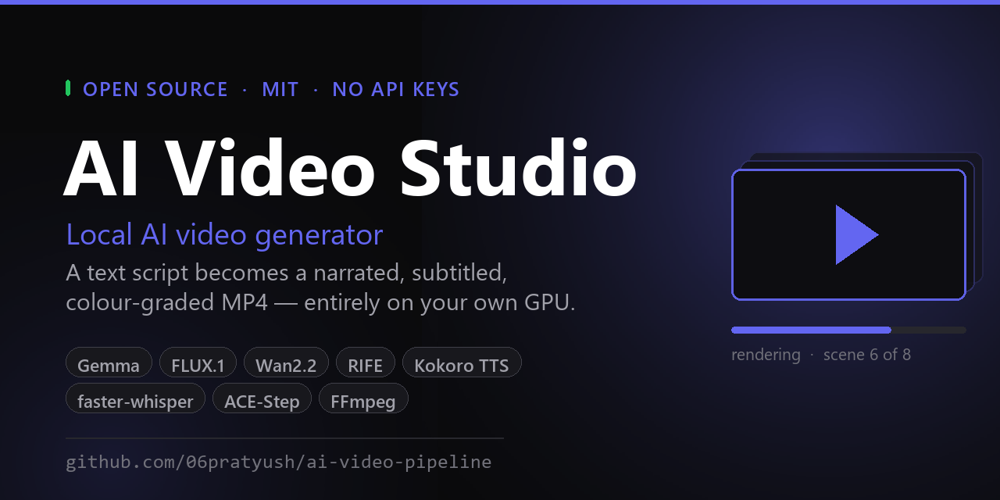

<div align="center">



<br>


# AI Video Studio

### Open-source AI video generator — text script to finished MP4, entirely on your own GPU.

*Turn a script into a narrated, professionally-edited video. No cloud. No subscriptions. No API keys.  
Your machine is the only computer in the loop.*

<br>

[](https://github.com/06pratyush/ai-video-pipeline/releases/latest)
[](LICENSE)
[](https://www.python.org/downloads/)
[](https://www.electronjs.org/)
[](https://react.dev/)
[](https://fastapi.tiangolo.com/)
[](https://developer.nvidia.com/cuda-toolkit)
[]()

<br>

[**Website**](https://06pratyush.github.io/ai-video-pipeline/) &nbsp;·&nbsp;
[**Download**](https://github.com/06pratyush/ai-video-pipeline/releases/latest) &nbsp;·&nbsp;
[**Quick Start**](#quick-start) &nbsp;·&nbsp;
[**Skills**](#skills) &nbsp;·&nbsp;
[**Architecture**](#architecture) &nbsp;·&nbsp;
[**Future work**](#future-work) &nbsp;·&nbsp;
[**FAQ**](#faq) &nbsp;·&nbsp;
[**Contributing**](CONTRIBUTING.md) &nbsp;·&nbsp;
[**Issues**](https://github.com/06pratyush/ai-video-pipeline/issues)

</div>

---

## What is AI Video Studio?

**AI Video Studio is a free, open-source, local AI video generator for Windows, Linux and macOS.**
You paste a text script, pick a style preset, and it produces a finished MP4 — narrated, scored,
subtitled and colour-graded — entirely on your own GPU. No cloud rendering, no API keys, no
subscription, and no footage ever leaves your machine.

It is a self-hosted alternative to hosted text-to-video services such as Runway, Pika and Sora, for
people who need offline operation, unlimited renders, or full control over their content pipeline.
Every stage is local and runs on your GPU: [Gemma](https://ai.google.dev/gemma) via
[Ollama](https://ollama.com) rewrites your script into scene prompts,
[FLUX](https://github.com/black-forest-labs/flux) draws each character once and then every scene's
first frame, [Wan2.2](https://github.com/Wan-Video/Wan2.2) animates those frames through
[ComfyUI](https://github.com/comfyanonymous/ComfyUI), [RIFE](https://github.com/hzwer/ECCV2022-RIFE)
smooths the motion to 48 fps, [Kokoro TTS](https://github.com/hexgrad/kokoro) speaks the narration,
[faster-whisper](https://github.com/SYSTRAN/faster-whisper) times every word for the captions,
[ACE-Step](https://github.com/ace-step/ACE-Step) scores it, and [FFmpeg](https://ffmpeg.org) (NVENC)
assembles the result.

| | |
|---|---|
| **Use it for** | YouTube explainers · TikTok / Reels / Shorts · documentary narration · product demos · tutorials · news recaps |
| **Runs on** | Windows 10/11 · Ubuntu 22.04+ · macOS 12+ · NVIDIA GPU with 8 GB VRAM — v2 is built and tested on an RTX 4060 **laptop** |
| **Costs** | Nothing — MIT licensed, no account, no metering, no telemetry |
| **Docs** | [Architecture](#architecture) · [Skills](#skills) · [Build from source](#build-from-source) · [Troubleshooting](#troubleshooting) · [Future work](#future-work) · [FAQ](#faq) · [Contributing](CONTRIBUTING.md) · [Review & merge policy](REVIEW_AND_MERGE.md) |

---

## What's new in v2

**Version 2.0 is the next major version of AI Video Studio, after [v1.0.0](https://github.com/06pratyush/ai-video-pipeline/releases/tag/v1.0.0).**
v1 described the pipeline; v2 is the version that renders a finished, consistent, smooth video on an
8 GB laptop GPU. Everything below was built and verified on an RTX 4060 Laptop (8 GB VRAM, 16 GB RAM).

| | v1.0.0 | v2.0 |
|---|---|---|
| **Renders a video at all** | No: the shipped ComfyUI workflow was an SD1.5 *image* graph, the client waited forever for a key ComfyUI never sends, and ComfyUI could not start (doubled path) | Yes, end to end, on an 8 GB laptop GPU |
| **Video model** | Wan2.1 1.3B / 14B | **Wan2.2 TI2V-5B**, 4-bit GGUF, text- *and* image-to-video |
| **Same character in every scene** | No: each clip from text alone | **Character sheet + keyframes**: FLUX draws each character once, then every scene's first frame with that character; Wan2.2 animates from the keyframe |
| **Smooth motion** | CPU `minterpolate` on the joined film; clips froze on their last frame | **RIFE 4.9 on the GPU, per clip, 24 → 48 fps**; dissolves land exactly on each new line; a slow camera push means no frame ever freezes |
| **Captions** | Timed by word count, drifting from the voice | **Word-synced**: faster-whisper times every spoken word, the script's own words are shown, the active word is highlighted |
| **Music** | MusicGen (CC-BY-NC weights, audiocraft hard to install on Windows) | **ACE-Step 3.5B** (Apache-2.0) on the GPU, ducked under the voice, mix at −14 LUFS |
| **GPU use** | Backend PyTorch was CPU-only | Every model stage on CUDA (TTS, Whisper, FLUX, Wan, RIFE, ESRGAN, ACE-Step), encodes on NVENC; `scripts/doctor.py` proves it |
| **Upscale** | CPU `super2xbr` | Optional Real-ESRGAN x2 on the GPU |
| **Model install** | Not wired | `scripts/setup_models.py`: resumable, exact-size and sha256 checked, host-allowlisted |
| **Tests** | Data-integrity tests | + 20 v2 tests incl. safety (no `shell=True`, local-only ComfyUI, download allowlist, path escapes, caption escaping) |

### v2 models (all local, all on the GPU)

| Stage | Model | Size | Licence |
|---|---|---|---|
| Animate | Wan2.2 TI2V-5B GGUF Q4_K_M + UMT5 GGUF + Wan2.2 VAE | 8.5 GB | Apache-2.0 |
| Keyframes (default) | FLUX.1 schnell GGUF Q4_K_S + T5 GGUF + CLIP-L + VAE | 10.3 GB | Apache-2.0 |
| Keyframes (best consistency) | FLUX.1 Kontext dev GGUF Q4_K_M | 6.9 GB | **Non-commercial** (FLUX.1 [dev]), flagged in the app |
| Music | ACE-Step v1 3.5B | 7.7 GB | Apache-2.0 |
| Smooth / sharpen | RIFE 4.9 · Real-ESRGAN x2plus | 0.09 GB | MIT · BSD-3 |
| Voice · timing | Kokoro 82M · faster-whisper small.en | 0.6 GB | Apache-2.0 · MIT |

Choose per video: `"consistency": "kontext"` gives the most consistent characters but its output may not be
monetised; `"schnell"` is fully commercial-friendly.

### Measured on an RTX 4060 Laptop (8 GB VRAM, 16 GB RAM)

The sample `stories/noahs_ark.json` is 13 scenes, 72 s of narration, and comes out as a 77 s,
1080×1920, 48 fps, stereo film at −13.7 LUFS:

| Stage | Time |
|---|---|
| Character sheets (FLUX schnell, 2 characters) | 81 s total |
| Keyframes (FLUX Kontext, 20 steps) | 3–8 min each, about 70 min for 13 (schnell, 4 steps: under a minute each) |
| Clips (Wan2.2 5B image-to-video, 121 frames, 480×832, 20 steps) | about 6 min each, about 78 min for 13 |
| Smoothing (RIFE 4.9, 24 → 48 fps) | 12–39 s each, 4 min 18 s for 13 |
| Music (ACE-Step 3.5B, 79 s of audio) | 34–40 s |
| Word timings (faster-whisper small.en, CUDA float16) | seconds, plus a one-time model download |
| Edit (dissolves, captions, mix, NVENC encode) | about 50 s |
| **Whole film** | **about 2 h 35 min** |

The app's render queue made a 2-scene project in 16 min. Keyframes are slower than the GPU alone would make
them: with 16 GB of RAM, ComfyUI cannot keep FLUX and T5 cached between prompts, so it reloads them every time.

### Make a video from a story file (laptop quick start)

```powershell
venv311\Scripts\python.exe scripts\setup_models.py          # downloads the v2 stack, verified
venv311\Scripts\python.exe scripts\doctor.py                # every stage ready and on the GPU?
venv311\Scripts\python.exe scripts\render_story.py stories\noahs_ark.json
```

`render_story.py` runs seven stages: `voice`, `refs`, `keyframes`, `clips`, `smooth`, `music`, `edit`.
Each stage skips files that already exist, so an interrupted render resumes. To redo particular scenes, use
`--stage keyframes --only 8`, then `--stage clips --only 8`. A story file is JSON with these parts:
- a `style`;
- `characters`, each with a description and a seed;
- `consistency`;
- a `music` prompt and `music_seed`;
- one `narration` and one `prompt` per scene, with an optional `cast`.

Write `{noah}` in a prompt to insert that character's description. If one keyframe comes out wrong, give
that scene a `keyframe` prompt (what the still should show, while `prompt` keeps describing the motion)
and/or a new `keyframe_seed`, then redo it with `--only`.

---

## Highlights

<table>
<tr>
<td width="33%" valign="top">

### Local-First
Everything runs on your machine.  
No telemetry, no cloud calls,  
no usage tracking, ever.

</td>
<td width="33%" valign="top">

### Five-Click Workflow
Paste script → pick Skill →  
toggle quality → hit Generate →  
download finished MP4.

</td>
<td width="33%" valign="top">

### 7 Built-in Skills
Documentary · Cinematic ·  
Social Short · Explainer ·  
Product · Tutorial · News

</td>
</tr>
<tr>
<td width="33%" valign="top">

### Smart VRAM Routing
Auto-downgrades when GPU is full.  
Live VRAM meter in the title bar.  
Sequential model lifecycle.

</td>
<td width="33%" valign="top">

### Templates & Batch
Save reusable configs.  
Queue 10 projects overnight.  
Auto-versioning per render.

</td>
<td width="33%" valign="top">

### Pro Quality Layer
Word-synced captions · ACE-Step score  
RIFE 48 fps · Real-ESRGAN 2×  
Cinematic colour grading

</td>
</tr>
</table>

---

## What it does

Write a script. Pick a Skill. Hit Generate. You get a finished MP4 with narration, visuals, music,
word-synced captions and colour grading — ready to post. How long that takes is the video model's
cost, not the app's: about **16 minutes** for a 2-scene project and **2 h 35 min** for a 13-scene
film on an RTX 4060 Laptop.

```
   ┌───────────────────┐
   │   Your script     │
   └─────────┬─────────┘
             │
   ╔═════════▼══════════════════════════════════════════════════════╗
   ║  THE PIPELINE                                                  ║
   ║  ────────────                                                  ║
   ║   [1]  Gemma (Ollama)        refines narration + scene prompts ║
   ║   [2]  Kokoro TTS  (GPU)     synthesizes voice audio           ║
   ║   [3]  FLUX (ComfyUI, GPU)   character sheet + scene keyframes ║
   ║   [4]  Wan2.2 5B   (GPU)     animates each keyframe            ║
   ║   [5]  RIFE 4.9    (GPU)     24 -> 48 fps per clip             ║
   ║   [6]  ACE-Step    (GPU)     composes background music         ║
   ║   [7]  Whisper     (GPU)     word timings -> synced captions   ║
   ║   [8]  FFmpeg      (NVENC)   dissolves, grade, duck, mux       ║
   ╚═════════╤══════════════════════════════════════════════════════╝
             ▼
   ┌───────────────────┐
   │    final.mp4      │
   └───────────────────┘
```

<details>
<summary><b>What runs at each stage</b></summary>

| Stage | Tool | When | Cost |
|-------|------|------|------|
| **Refine narration** | Gemma 3 / 4B via Ollama | Always | ~10s |
| **Generate scene prompts** | Gemma 3 / 4B | Always | ~10s |
| **Voice synthesis** | Kokoro TTS (8 voices) | Always | ~5s per 100 words |
| **Keyframes** | FLUX.1 schnell / Kontext (GGUF) | When installed | see v2 timings |
| **Video clips** | Wan2.2 TI2V-5B GGUF | Always | ~6–7 min per 5 s scene (RTX 4060 Laptop) |
| **Frame interpolation** | RIFE 4.9 in ComfyUI (GPU) | Default on | ~40 s per scene |
| **Upscaling** | Real-ESRGAN x2 in ComfyUI (GPU) | Optional | ~7 min per scene |
| **Background music** | ACE-Step 3.5B (GPU) | With a music mood | see v2 timings |
| **Subtitles** | faster-whisper (GPU), word timestamps | Optional | seconds |
| **Color + mux** | FFmpeg `curves` + `eq` + `concat` | Always | ~30s |

</details>

---

## Install

<table>
<tr>
<td width="50%" valign="top">

### Windows
NSIS installer or portable .exe
```
AI-Video-Studio-2.0.1-x64.exe
AI-Video-Studio-2.0.1-x64-portable.exe
```

### Linux
AppImage (universal) or .deb
```
AI-Video-Studio-2.0.1-x86_64.AppImage
AI-Video-Studio-2.0.1-amd64.deb
```

### macOS
DMG for Apple Silicon or Intel
```
AI-Video-Studio-2.0.1-arm64.dmg
AI-Video-Studio-2.0.1-x64.dmg
```

</td>
<td width="50%" valign="top">

### First-launch timeline

```
00:00  ░░░░░░░░░░░░░░░░░░░░  Python + venv setup
01:30  ████░░░░░░░░░░░░░░░░  PyTorch + CUDA download
06:00  ████████░░░░░░░░░░░░  ComfyUI clone + deps
10:00  ████████████░░░░░░░░  Wan2.2 + FLUX model download
14:00  ████████████████░░░░  Ollama LLM pull
17:00  ████████████████████  Ready
```

After that, render time is set by the video model, not the install: a 2-scene project is about
**16 minutes** and a 13-scene, 77-second film about **2 h 35 min** on an RTX 4060 Laptop. See
[the measured breakdown](#measured-on-an-rtx-4060-laptop-8-gb-vram-16-gb-ram).

</td>
</tr>
</table>

<details>
<summary><b>Build from source instead</b></summary>

```bash
git clone https://github.com/06pratyush/ai-video-pipeline.git
cd ai-video-pipeline

# Windows
start.bat

# Linux / macOS
./start.sh
```

The launcher checks for Python 3.10+ and Node.js 18+, then runs the same bootstrap process as the installer.

</details>

---

## System Requirements

|                | Minimum                    | Recommended                |
|----------------|----------------------------|----------------------------|
| **GPU**        | NVIDIA · 8 GB VRAM (laptop OK) · Wan2.2 5B GGUF | NVIDIA · 12 GB+ VRAM |
| **RAM**        | 16 GB                      | 32 GB                      |
| **Disk**       | 45 GB free (v2 models ~34 GB) | 100 GB free             |
| **OS**         | Win 10 · Ubuntu 22.04 · macOS 12 | Win 11 · Ubuntu 24.04 · macOS 14 |
| **Python**     | 3.10                       | 3.11                       |
| **Node.js**    | 18 LTS                     | 20 LTS                     |

CPU-only mode is not practical for video. AMD GPUs are not supported yet. Run `scripts/doctor.py` to confirm that every stage will use your GPU.

---

## Quick Start

After installation, the app shows a five-step onboarding card. Dismiss it and:

1. **Click + New Project** in the sidebar
2. **Paste your script** in the Script tab — anything from one sentence to several paragraphs
3. **Pick a Skill** — Documentary, Cinematic Story, Explainer, Social Short, Product Showcase, Tutorial, or News Brief. The Skill bundles voice, pacing, visual style, music mood, and post-processing into one preset.
4. **Switch to Render tab** and toggle the quality options you want (subtitles, music, frame interpolation, upscaling)
5. **Hit Generate Video** — the queue strip at the bottom shows live progress through 8 stages

When the render finishes, click `Download MP4` to save it, or `Show in folder` to open the output directory.

---

## Skills

A Skill is a preset that determines the entire look and feel of the output. The default pack ships seven:

| Skill | Voice | Pacing | Aspect | Best For |
|-------|-------|--------|--------|----------|
| **Documentary**     | George (British male)   | Slow   | 16:9 | Long-form narration, nature, history |
| **Explainer**       | Sarah (American female) | Medium | 16:9 | Concept videos, tutorials |
| **Product Showcase** | Michael (American male) | Medium | 1:1  | Marketing, demos |
| **Cinematic Story** | George (British male)   | Slow   | 16:9 | Storytelling, dramatic content |
| **Social Short**    | Heart (American female) | Fast   | 9:16 | TikTok, Reels, Shorts |
| **Tutorial**        | Nicole (American female) | Medium | 16:9 | How-to content |
| **News Brief**      | Adam (American male)    | Fast   | 16:9 | News updates, recaps |

Each Skill bundles a prompt template, voice + speed, scene pacing hint, music mood, and post-processing chain (color grade, film grain, letterbox). Custom Skills are JSON files in `app/skills/` — duplicate one to make your own.

> **Pro tip:** Pick a Skill that matches your target platform. Social Short auto-formats for vertical mobile with subtitles enabled; Documentary applies cinematic letterbox bars and slow pacing.

---

## Quality Settings

The Render tab exposes four toggles independent of the Skill:

| Toggle | Backend Module | Cost |
|--------|----------------|------|
| **Subtitles**           | faster-whisper word timestamps (GPU) → burned-in ASS, active word highlighted | seconds for a whole film |
| **Background Music**    | ACE-Step 3.5B (GPU), mood-matched, ducked under the voice, mixed to −14 LUFS | ~35–40 s per 80 s of audio |
| **Frame Interpolation** | RIFE 4.9 in ComfyUI (GPU), per clip, 24 → 48 fps | 12–39 s per clip |
| **Upscaling**           | Real-ESRGAN x2plus in ComfyUI (GPU) | ~7 min per scene |

All four run on the GPU in v2. The CPU paths they replaced — `minterpolate` and `super2xbr` — are
gone from the render path, and MusicGen is kept only as a fallback behind ACE-Step, because its
weights are CC-BY-NC and so cannot be monetised. `scripts/doctor.py` proves which device each
stage actually runs on.

Skills auto-enable some toggles by default (e.g. Social Short turns on subtitles because mobile viewers watch muted).

---

## Templates, Versions, Batch

After your first successful render, three workflow accelerators become useful:

<table>
<tr>
<td width="33%" valign="top" align="center">

### Templates

Save reusable presets with skill, voice, scenes, quality settings.  
Apply with two clicks.

</td>
<td width="33%" valign="top" align="center">

### Version History

Every render auto-snapshots script + prompts + final MP4.  
Restore any earlier version.

</td>
<td width="33%" valign="top" align="center">

### Batch Generation

Queue 10 projects at once.  
Optionally apply one template to all.  
Renders sequentially overnight.

</td>
</tr>
</table>

---

## Architecture

Three-tier system designed so each layer can evolve independently:

```
╔══════════════════════════════════════════════════════════════╗
║   ELECTRON FRONTEND        React 18 · Vite · Zustand · TW    ║
║   ─────────────────                                          ║
║   • Project library · script editor · render panel           ║
║   • Real-time WebSocket progress · live VRAM meter           ║
║   • Model browser · template browser · batch modal           ║
╚════════════════════════════╤═════════════════════════════════╝
                             │   REST + WebSocket
                             │   http://localhost:7860
                             ▼
╔══════════════════════════════════════════════════════════════╗
║   PYTHON BACKEND DAEMON    FastAPI · SQLAlchemy · uvicorn    ║
║   ────────────────────                                       ║
║   • Generation queue (SQLite persistence, survives restarts) ║
║   • VRAM-aware model lifecycle, smart fallback routing       ║
║   • Scene cache (sha256 of prompt+seed+model+resolution)     ║
║   • 11 REST routes · 1 WebSocket · auto-update checker       ║
╚═══════╤═══════════════════╤══════════════════╤═══════════════╝
        ▼                   ▼                  ▼
   ┌─────────┐         ┌─────────┐         ┌─────────┐
   │ Ollama  │         │ ComfyUI │         │ FFmpeg  │
   │ Gemma   │         │ Wan2.2  │         │ Kokoro  │
   │ + LLMs  │         │ + nodes │         │ Whisper │
   └─────────┘         └─────────┘         └─────────┘
        ▲                   ▲                  ▲
        │              spawned as              │
        └────── subprocesses by daemon ────────┘
```

The frontend talks to the backend only via REST + WebSocket on `localhost:7860`. All ML work happens in Python. The Electron shell is purely a presentation layer.

<details>
<summary><b>Repository layout</b></summary>

```
ai-video-pipeline/
│
├── start.bat / start.sh         ← platform launchers
├── README.md
├── LICENSE
│
├── installer/
│   ├── bootstrap.py             ← first-run dependency installer
│   ├── system_check.py
│   └── catalog.json             ← available models metadata
│
└── app/
    ├── backend/                 ← FastAPI daemon (Python)
    │   ├── main.py, daemon.py, db.py, version.py
    │   ├── routes/              ← 11 REST endpoints
    │   ├── services/            ← queue, cache, VRAM, registry
    │   ├── pipeline/            ← Gemma, Kokoro, Wan, Whisper, MusicGen,
    │   │                           XTTS, RIFE, ESRGAN, FFmpeg
    │   └── models/              ← SQLAlchemy ORM
    │
    ├── frontend/                ← Electron + React + Vite
    │   ├── electron/main.ts + preload.ts
    │   └── src/components/      ← React UI
    │
    ├── runtime/                 ← created at first launch
    │   ├── python/              ← bundled venv
    │   ├── comfyui/             ← cloned ComfyUI
    │   └── models/              ← downloaded weights
    │
    ├── skills/                  ← 7 JSON Skill presets
    └── projects/                ← user projects per-id
```

</details>

---

## Build from source

Build the desktop installers yourself if you don't want to use the GitHub releases:

```bash
cd app/frontend
npm install
npm run build:win     # Windows: NSIS .exe + portable .exe
npm run build:linux   # Linux: AppImage + .deb
npm run build:mac     # macOS: DMG + zip (x64 + arm64)
npm run build:all     # All three platforms (requires macOS host for proper signing)
```

Artifacts land in `app/frontend/release/`. Code signing requires the matching host OS — macOS DMGs must be built on macOS for notarization to work.

---

## Troubleshooting

**Setup screen stalls on PyTorch install**  
Slow disk + 2.5GB download. Check the log viewer at the bottom of the setup screen. If it's been more than 20 minutes, retry from the setup screen's retry button.

**"Cannot connect to Ollama" during generation**  
Ollama crashed or wasn't started. The app tries to start it automatically — open the Model Browser to verify Ollama models are listed. If empty, run `ollama serve` in a terminal.

**Backend status shows "ComfyUI: not running"**  
ComfyUI starts lazily on first generation. If it fails to start, check that `app/runtime/comfyui/` exists and contains a `main.py`. Re-run the bootstrap if not.

**"CUDA out of memory" mid-generation**  
v2 ships one video model, so there is nothing smaller to fall back to. The queue checks free VRAM before the stage and warns "Low VRAM (…MB free, need …MB) — generation may fail" rather than downgrading; Wan2.2 TI2V-5B needs about 6 GB free on top of whatever else is resident. The daemon already unloads the Ollama model before the video stage, so what is left is other software: close other GPU apps (Chrome with hardware acceleration uses 1–2 GB), or restart the daemon to clear a leaked ComfyUI context.

**Black bars / wrong aspect ratio in output**  
The Skill controls aspect ratio. Social Short → 9:16, all others → 16:9 by default. Change the Skill or duplicate one and edit the JSON.

**Subtitles look misaligned**  
Whisper is mis-transcribing the audio. Try regenerating audio with a different voice (some skills' default voices Whisper handles better than others).

Open an issue on GitHub if you hit a symptom not covered above — include OS, GPU model, VRAM, and the exact reproduction steps.

---

## Future work

v2 renders a finished film on an 8 GB laptop GPU. What it does not yet have is *range*: one
keyframe engine, one video model, seven Skills, and one look per Skill. The four areas below are
where the project is deliberately unfinished, and where a contribution has the most leverage.
Every limitation named here is a real, reproduced one — the ones marked `GAP-nn` are tracked in
[CONTEXT.md](CONTEXT.md), this project's engineering log.

### Skills for AI

A Skill is the preset that decides the whole look and feel of a render: prompt template, voice,
pacing, music mood, post chain. There are seven, all plain JSON in `app/skills/`, so this is the
one area that needs no Python at all.

| Wanted | Why it is open |
|---|---|
| **More Skills** | Interview, podcast-to-video, audiobook chapter, recipe, sports recap, lecture, devlog. One JSON file each — copy the nearest and change it |
| **Skills that hold a cast** | The v2 story format already renders a two-hander, with a per-scene `voice` and silent beats that keep their slot on the timeline. The Skill layer cannot express any of it, so dialogue is reachable only by hand-writing a story file |
| **Installable Skill packs** | A folder or URL of Skills, validated against a published schema at load, so a look can be shared without a pull request |
| **Captions per Skill** | Font, size, position and highlight colour live in the story file today, not in the Skill |
| **Model-aware prompt templates** | The same template is sent to FLUX schnell and FLUX Kontext, which want different wording — see *Image generation* below |

### Styles and looks

Everything between the rendered clip and the finished file: grade, grain, framing, type.

| Wanted | Why it is open |
|---|---|
| **Grades as data** | The grade is FFmpeg `curves` + `eq` written into the merger. Moving presets into files, and supporting a 3D LUT (`lut3d`, a `.cube` file), makes a look a shareable asset rather than a code change |
| **Film emulation** | Grain, halation, bloom, vignette, gate weave — each a small, independently testable filter stage |
| **Caption placement per scene** | `GAP-08`. Caption height is one story-level constant, so a piece that cuts between wide shots and tight close-ups has a single compromise position; at the height that suited a reference short, the band crossed an actor's eyes in every close-up. Deriving it from where the face is would close this |
| **A compositing stage** | There is none, and this is the largest missing capability in the edit path. A 5B video model does not render designed overlays, so lower thirds, titles, callouts, logos and end cards cannot be produced at all today |

### Image generation

Keyframes and character sheets — FLUX.1 schnell for speed, FLUX.1 Kontext dev for consistency.
This stage decides whether a character is still the same person in scene 20.

| Wanted | Why it is open |
|---|---|
| **Shot-aware prompt building** | Kontext defends the reference sheet's *framing* as well as its identity. Eight scenes of the sample dialogue short came back at the character sheet's distance and only moved after a hand-written per-scene `keyframe` prompt naming the shot. A builder that knows the shot size removes that manual step |
| **Text that survives diffusion** | Long numerals lose digits: a `$165.00` price sticker came back as `$16.00` on one of five seeds tried. The current fix is a pinned seed per insert. Rendering small text in post, or routing text inserts to a model that handles glyphs, would be a real fix |
| **Props, not just characters** | Reference conditioning covers the cast; a prop drifts. A wine bottle alternated between white and red across four consecutive shots until its colour was pinned by hand in every prompt |
| **More engines** | SDXL, SD3.5, Qwen-Image behind the same ComfyUI client — and above all a **fully commercial-licensed consistency path**, because the best one today, FLUX.1 Kontext dev, is non-commercial and the app has to flag it |
| **Keep the model resident** | Keyframes are the slowest stage on a 16 GB machine because of RAM, not the GPU: ComfyUI cannot cache FLUX and T5 between prompts and reloads them every time |

### Video generation

Animating each keyframe — Wan2.2 TI2V-5B, 4-bit GGUF, through ComfyUI.

| Wanted | Why it is open |
|---|---|
| **Render at the model's own resolution** | `GAP-09`, and the dominant quality lever. Clips default to 480×832 while Wan2.2 TI2V-5B is trained at 704×1280, so the stage discards detail the keyframe stage already paid for. At full resolution a bottle label reads correctly and fingers resolve individually — and two minutes of film costs about twelve hours on an 8 GB card. Block swapping, attention kernels and an offload strategy measured per GPU are what make that affordable |
| **More video models** | Wan2.2 14B, LTX-Video, HunyuanVideo, CogVideoX behind one client interface, with VRAM-aware routing choosing between them |
| **Shots longer than one clip** | Chaining a clip's last frame into the next clip's first frame lets a shot run past the model's frame budget without a cut |
| **Camera motion from the model** | v2 removed the synthetic camera push from the edit stage: quantised to whole pixels it produced a 4.8 Hz tick that cancelled the RIFE interpolation the smooth stage spends ten minutes producing. Camera movement belongs in the video model's conditioning, not in a filter |
| **Non-NVIDIA hardware** | An AMD ROCm path, and Apple Silicon. Everything today assumes CUDA |
| **Cancel inside a clip** | `GAP-05`. A cancel is observed at scene boundaries, so one long clip must finish first |

Pick one and [open an issue](https://github.com/06pratyush/ai-video-pipeline/issues/new/choose)
before starting — for work this size, agreeing the design first is the step that saves a rewrite.

---

## Contributing

Contributions are welcome, and the full guide lives in **[CONTRIBUTING.md](CONTRIBUTING.md)** —
development setup, code style, how to add a Skill or a pipeline module, and how to raise a pull
request. How that request is then reviewed, approved and merged is documented separately in
**[REVIEW_AND_MERGE.md](REVIEW_AND_MERGE.md)**.

Good places to start, roughly easiest first:

| Area | What is wanted |
|------|----------------|
| **New Skills** | A JSON preset in `app/skills/` — no Python needed. See [Adding a Skill](CONTRIBUTING.md#adding-a-skill) |
| **Colour grades** | Extra FFmpeg post-processing presets in `pipeline/ffmpeg_merger.py` |
| **Docs & troubleshooting** | Symptoms you hit that [Troubleshooting](#troubleshooting) does not cover |
| **Tests** | Automated coverage is a Phase 9 goal; `app/backend/tests/` is the beachhead |
| **Colour LUTs** | `.cube` support so a look is a file, not a code change — see [Future work](#future-work) |
| **AMD ROCm support** | A working Wan2.2 path for non-NVIDIA GPUs |
| **Mobile companion** | Trigger and monitor renders from a phone |

Larger, open-ended work — new Skills, new looks, other keyframe and video models — is set out in
**[Future work](#future-work)**, with the reason each one is still open.

Before starting anything large, [open an issue](https://github.com/06pratyush/ai-video-pipeline/issues/new/choose)
so the design can be agreed first — that is the step that most often saves a rewrite.

New here? Issues labelled [`good first issue`](https://github.com/06pratyush/ai-video-pipeline/labels/good%20first%20issue)
are scoped to be completable without knowing the whole pipeline.

---

## FAQ

<details>
<summary><b>Is AI Video Studio free?</b></summary>

Yes. It is MIT licensed and free permanently. There is no account, no metering, no paid tier and no
telemetry. The only costs are your electricity and disk space.

</details>

<details>
<summary><b>Does it work offline?</b></summary>

Yes, after setup. The first launch installs the runtime — Python and a venv, PyTorch and CUDA,
ComfyUI and its dependencies, and the Ollama model — and downloads the v2 model stack, about
34 GB, so how long that part takes depends on your connection. After that every render runs
entirely on your machine and you can stay disconnected permanently. The only outbound request the
app ever makes is an optional update check against GitHub Releases.

</details>

<details>
<summary><b>Do I need an NVIDIA GPU?</b></summary>

For usable speed, yes — 8 GB VRAM minimum, 16 GB or more recommended. CPU-only mode runs but is
roughly 10x slower, which means hours rather than minutes per video. AMD GPUs are not supported yet
because the GGUF video path has no tested ROCm build.

</details>

<details>
<summary><b>How long does one video take to generate?</b></summary>

Longer than a hosted service, because the video model runs on your own card. Measured on an RTX
4060 Laptop (8 GB VRAM, 16 GB RAM): about **16 minutes** for a 2-scene project through the render
queue, and about **2 h 35 min** for a 13-scene, 77-second film. Animating the clips is most of it,
at roughly 6 minutes a scene; smoothing adds 12–39s per clip, music 34–40s for 80s of audio, and
captions seconds for the whole film. Optional Real-ESRGAN upscaling is the expensive extra, at
about 7 minutes a scene — see
[the measured breakdown](#measured-on-an-rtx-4060-laptop-8-gb-vram-16-gb-ram).

</details>

<details>
<summary><b>How is this different from Runway, Pika or Sora?</b></summary>

Those are hosted services: you submit a prompt, their GPUs render it, and you pay per generation
under their content policy. AI Video Studio runs the same class of pipeline on hardware you own, so
you get unlimited renders, no upload, no content review and no recurring cost — in exchange for
needing a capable GPU and the patience for a local render.

</details>

<details>
<summary><b>Can I use the generated videos commercially?</b></summary>

The application is MIT licensed, so the code is yours to use. Output rights depend on the models you
run — Wan2.2, FLUX, ACE-Step, Gemma, Kokoro and Whisper each carry their own licence. FLUX.1 Kontext dev
is **non-commercial**; use `"consistency": "schnell"` for monetised videos. Check each model's
terms against your intended use; this project cannot grant rights it does not hold.

</details>

<details>
<summary><b>Where are my videos stored?</b></summary>

Under `app/projects/<project-id>/` beside the application, indexed by an SQLite database at
`app/backend/db.sqlite`. Nothing is uploaded. Note that deleting a project removes its database rows
but leaves the media on disk — a known shortcoming tracked as GAP-01 in [CONTEXT.md](CONTEXT.md).

</details>

<details>
<summary><b>Can I add my own voice or visual style?</b></summary>

Yes. Voices clone from a reference clip through XTTS v2 in the Voices panel. Visual styles are
"Skills" — plain JSON files in `app/skills/` bundling voice, pacing, aspect ratio, music mood and the
FFmpeg post-processing chain. Copy one and edit it; see [Skills](#skills) and
[Adding a Skill](CONTRIBUTING.md#adding-a-skill).

</details>

---

## License

[MIT](LICENSE) — use it, modify it, distribute it freely. Attribution appreciated but not required.

---

## Acknowledgements

Built on the shoulders of these excellent open-source projects:

<table>
<tr>
<td valign="top" width="50%">

**AI Models**
- [Wan2.2](https://github.com/Wan-Video/Wan2.2) · text/image-to-video
- [FLUX.1](https://github.com/black-forest-labs/flux) · keyframes and character sheets
- [ACE-Step](https://github.com/ace-step/ACE-Step) · music
- [RIFE](https://github.com/hzwer/ECCV2022-RIFE) · frame interpolation
- [Real-ESRGAN](https://github.com/xinntao/Real-ESRGAN) · upscaling
- [Gemma](https://ai.google.dev/gemma) · LLM for script work
- [Kokoro TTS](https://github.com/hexgrad/kokoro) · text-to-speech
- [faster-whisper](https://github.com/SYSTRAN/faster-whisper) · transcription
- [MusicGen](https://github.com/facebookresearch/audiocraft) · music (fallback)
- [XTTS v2](https://github.com/coqui-ai/TTS) · voice cloning

</td>
<td valign="top" width="50%">

**Runtime & Frameworks**
- [ComfyUI](https://github.com/comfyanonymous/ComfyUI) · diffusion node runtime
- [Ollama](https://ollama.com) · local LLM serving
- [FFmpeg](https://ffmpeg.org) · multimedia framework
- [Electron](https://www.electronjs.org/) + [React](https://react.dev/) + [Vite](https://vitejs.dev/)
- [FastAPI](https://fastapi.tiangolo.com/) + [SQLAlchemy](https://www.sqlalchemy.org/)
- [Tailwind CSS](https://tailwindcss.com/) + [Zustand](https://zustand-demo.pmnd.rs/)

</td>
</tr>
</table>

---

<div align="center">

### *Built for creators who want full control over their AI content pipeline.*

**No subscriptions · No rate limits · No data leaving your machine.**

<br>

<sub>
<a href="https://github.com/06pratyush/ai-video-pipeline/stargazers">Star this repo</a> if it's useful ·
<a href="https://github.com/06pratyush/ai-video-pipeline/issues">Report an issue</a> ·
<a href="https://github.com/06pratyush/ai-video-pipeline/discussions">Ask a question</a>
</sub>

<br><br>

<sub>Released under the MIT License · v2.0.1</sub>

</div>
